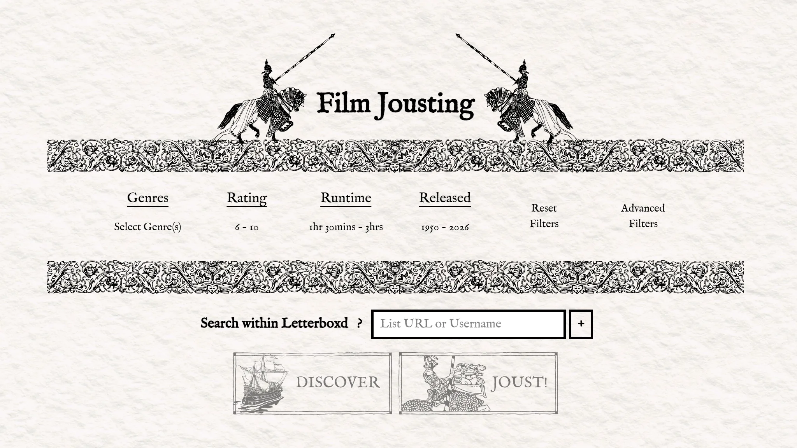
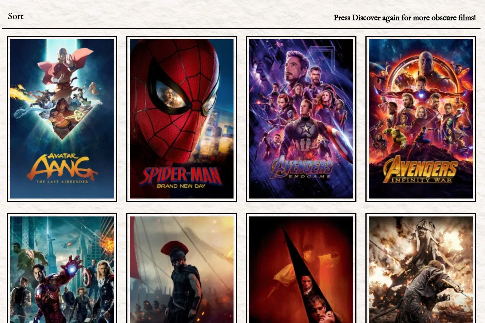
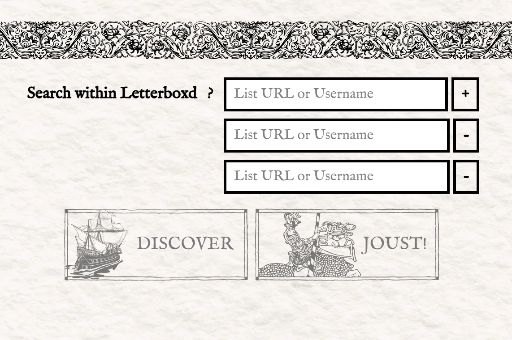
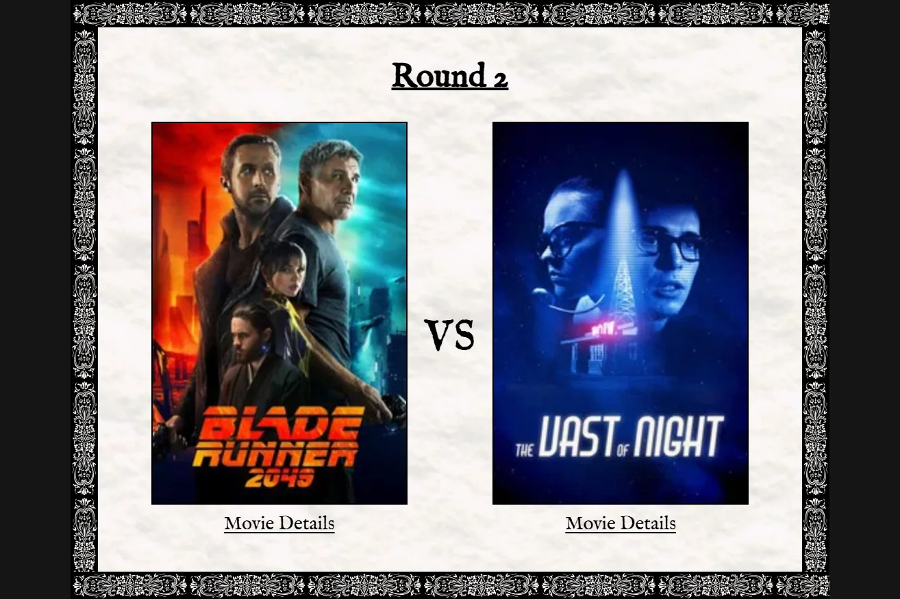
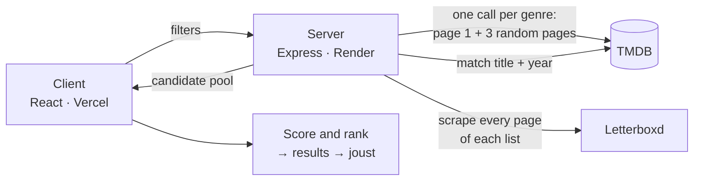

# Film Jousting

Film Jousting is a site designed to help you and your friends settle the age old question of "What movie should we watch?" Set filters to search for movie recommendations from the ether or from within an existing Letterboxd list (this works for any person's watchlist or public list!)

Still not sure which movie to watch? Run a selected top few through a head-to-head tournament bracket until one film is crowned champion!!

A passion project made by your friendly neighborhood film enthusiast. The recommendations are designed to have a degree of randomness every time you discover. Want to see different results? Re-Discover! Happy watching!

**Live:** [film-jousting.vercel.app](https://film-jousting.vercel.app) · **Case study:** [maggiemshen.com/projects/film-jousting](https://maggiemshen.com/projects/film-jousting)



| Discover | Letterboxd lists | The joust |
| --- | --- | --- |
|  |  |  |

## Features

- TMDB discover calls with random deep-page pulls for diversity
- Custom scoring engine
- Letterboxd watchlist scraping with pagination and TMDB enrichment
- In-memory caching for TMDB lookups
- Medieval manuscript UI with custom illustrations

## Tech stack

- **Client**: React, TypeScript, Vite, Tailwind CSS v4
- **Server**: Express, TypeScript
- **Data**: [TMDB API](https://www.themoviedb.org/documentation/api) for movie data, Letterboxd scraping for list import

## How it works



The server handles what the browser can't, like calling TMDB with a private key and scraping Letterboxd. Scoring runs in the browser, so changing a joust setting re-ranks results instantly.

## Key decisions

- **One TMDB call per genre.** TMDB treats every genre in a search equally and ranks by popularity, so popular genres like action crowd out niche ones like documentary. A separate call per genre guarantees each genre's best results reach the pool.
- **Random deep pages.** TMDB caps each call at 20 movies. Each genre's call takes the first page of popular picks plus three random pages from deeper in the results, so lesser-known films outnumber the popular picks without losing them entirely. A 200-vote minimum drops films with too few votes for their rating to mean much; the advanced filters can override it, or skip the most popular films. Discovering again pulls the next page and a new set of random pages until the pool runs out.
- **A custom scoring engine** ([`scoring.ts`](client/src/lib/scoring.ts)). TMDB can only sort by rating or popularity within one call. Every film starts from its TMDB rating. Genre matches multiply that score instead of adding to it, so a great film gains more from a match than a mediocre one, and a "Yes" counts for more than a "Maybe". Films get another boost for every extra Letterboxd list they appear on.
- **A bracket you shape.** A joust is 8, 16 or 32 films, picked by recommendation, rating or popularity. You can favor hidden gems, skip the most popular films or shuffle the lineup.
- **Scraping Letterboxd.** Letterboxd has no open API, so the server scrapes each list with Cheerio, follows its pages to the end, and matches every title to TMDB by title and year. It accepts a username, a list URL or a boxd.it short link.
- **Separate front and back end.** The client is on Vercel and the server on Render's free tier, which sleeps when idle. [maggiemshen.com](https://maggiemshen.com) pings `/api/health` on load, so the server is usually awake by the time someone opens the app.

## Run it locally

You need Node and a free [TMDB API key](https://www.themoviedb.org/settings/api).

```bash
git clone https://github.com/m-m-s/filmJousting.git
cd filmJousting
npm install
npm install --prefix client
npm install --prefix server
cp server/.env.example server/.env   # then add your TMDB_API_KEY
npm run dev
```

`npm run dev` starts both halves: the client at http://localhost:5173 and the server at http://localhost:3001. `DISCORD_WEBHOOK_URL` is optional; only the contact form uses it.

```
client/src/
  components/   filters, results grid, joust screens
  hooks/        filter state, movie fetching
  lib/          scoring.ts, joust.ts, filters.ts
server/src/
  routes/       /api/tmdb (genres, search, discover, letterboxdList), /api/contact
  services/     tmdbService.ts, letterboxdService.ts
```

## Credits

- This product uses the TMDB API but is not endorsed or certified by TMDB.
- Background texture photo by Olga Thelavart on Unsplash.
- Illustrations from Rawpixel.
- "Romantik" typeface via dafont (free for personal use).
- "IM Fell English" typeface by Igino Marini, under the SIL Open Font License.

Personal, non-commercial project.
